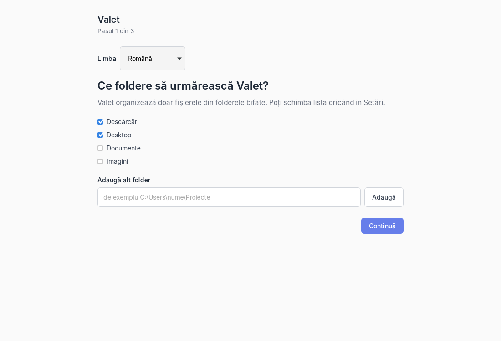
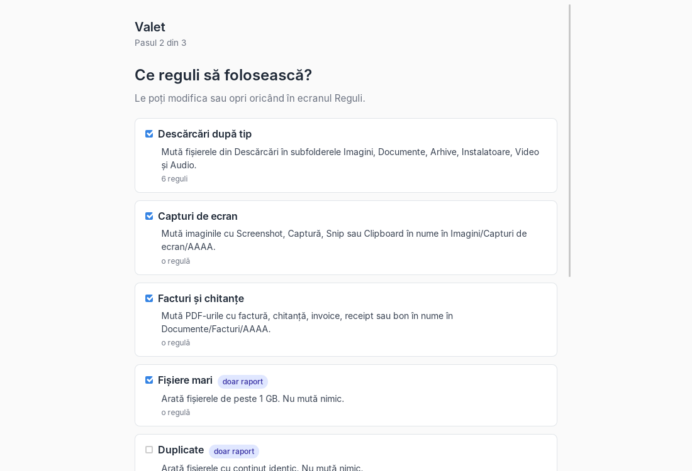
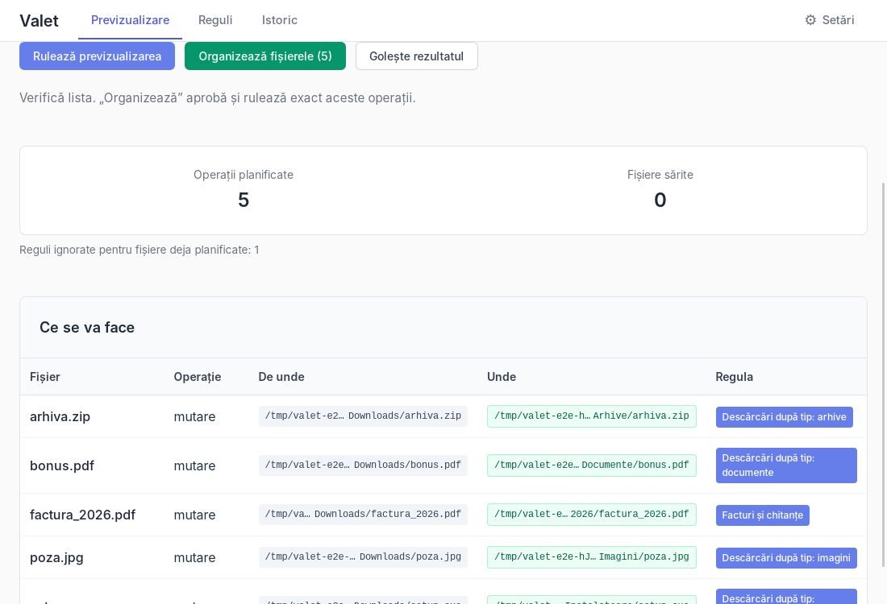
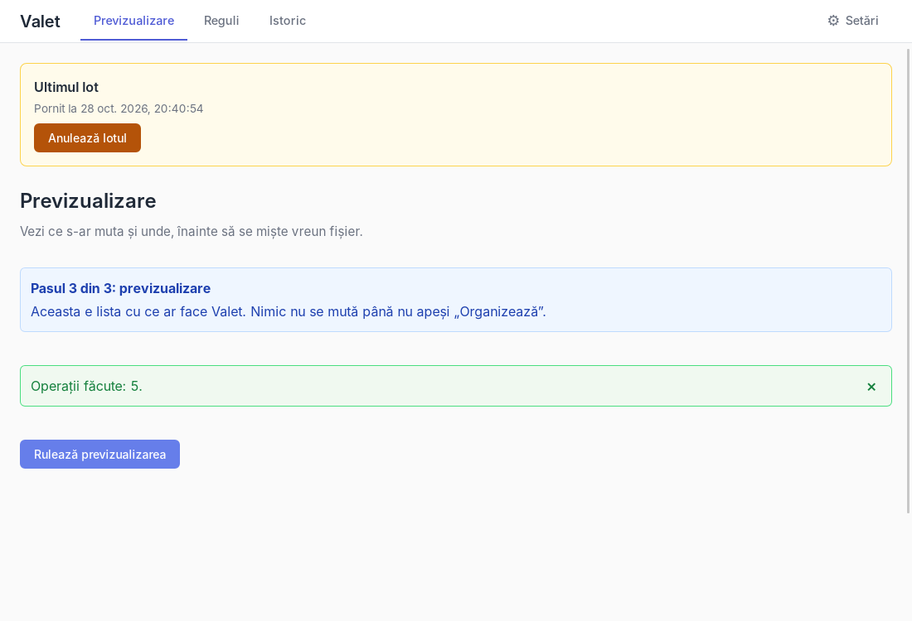
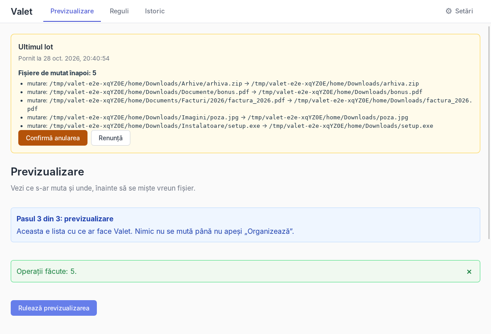
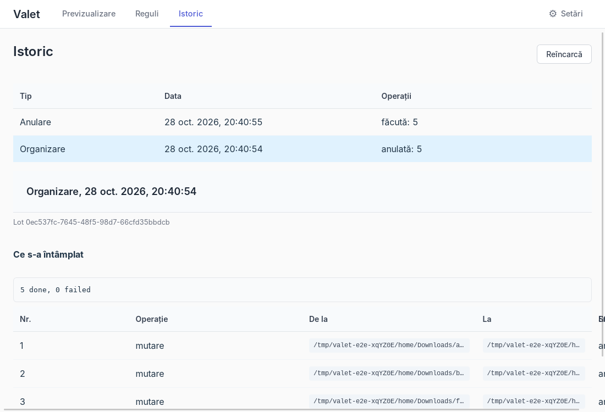
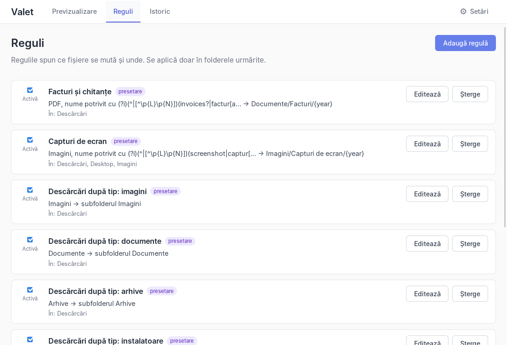
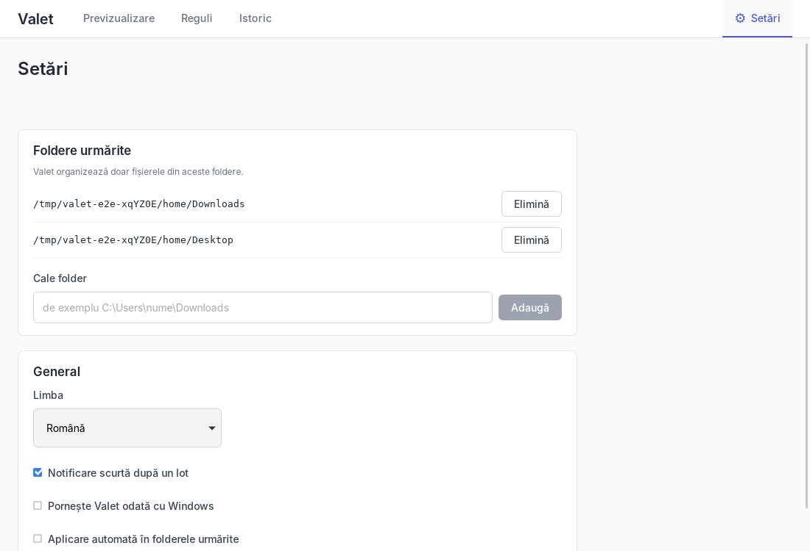

# Valet user guide

Versiunea în română: [USER_GUIDE.ro.md](USER_GUIDE.ro.md)

Valet puts your files in order, using rules you can see and undo. This guide describes what the app does in the version in this repository.

Valet is still in testing. No version has been published yet. When one is, the installer will be on the GitHub Releases page ([section 17](#17-installing-updates-and-uninstalling) says how to install it and why Windows warns); until then you start it from the source code (see [README.md](../README.md)). Until you trust it, work on folders where you have copies of your files.

Valet has a Free plan with limits and a Pro plan. The first 14 days have all the Pro features. Licenses are not active in the current builds: buying and activating a license does not work yet. Details in [section 18](#18-valet-pro-and-the-free-plan).

The screenshots show test folders, which is why the paths start with `/tmp/valet-e2e-…`. They were taken from the real app, on Linux, by the automatic UI smoke test. The app was in Romanian, so the screenshots show Romanian text. On Windows, paths look like `C:\Users\name\Downloads`. The names below are the English interface names.

## Contents

1. [What Valet does and does not do](#1-what-valet-does-and-does-not-do)
2. [First run](#2-first-run)
3. [The Preview](#3-the-preview)
4. [Organize](#4-organize)
5. [Undoing a batch](#5-undoing-a-batch)
6. [History](#6-history)
7. [The 8 presets](#7-the-8-presets)
8. [Writing your own rules](#8-writing-your-own-rules)
9. [Automatic organizing](#9-automatic-organizing)
10. [Tray and starting with Windows](#10-tray-and-starting-with-windows)
11. [Settings](#11-settings)
12. [What Valet never touches](#12-what-valet-never-touches)
13. [Drives without a Recycle Bin](#13-drives-without-a-recycle-bin)
14. [Privacy](#14-privacy)
15. [Where the data is](#15-where-the-data-is)
16. [Known limits](#16-known-limits)
17. [Installing, updates and uninstalling](#17-installing-updates-and-uninstalling)
18. [Valet Pro and the Free plan](#18-valet-pro-and-the-free-plan)

## 1. What Valet does and does not do

**What it does**

- It watches the folders you choose, for example Downloads and Desktop.
- It applies the active rules to the files in those folders. A rule can move a file, copy it, send it to the Recycle Bin, or only report it.
- It shows a list of what it would do (the preview) before it touches a file.
- It writes every operation to a journal before it does it. You see the journal on the History screen.
- It can undo a whole batch.
- If the app or the computer stops in the middle of a batch, it checks the unfinished operations at the next start.
- It can organize new files by itself, but only after you have approved a preview (see [section 9](#9-automatic-organizing)).
- It has a Free plan, with limits, and a Pro plan (see [section 18](#18-valet-pro-and-the-free-plan)).

**What it does not do**

- It never deletes anything permanently. Every removal goes to the Windows Recycle Bin.
- It never overwrites a file. If the name at the destination is taken, the file gets `name (2).ext`, then `name (3).ext`, and so on.
- It does not rename files and it does not tag them. These actions do not exist in the current version.
- It does not read file contents to classify files. Rules look at the name, extension, type, size, dates and path. The only reading of contents is the hash check of files it moves, copies or sends to the Recycle Bin, and the comparison of same-size files for duplicate rules.
- It uses the internet for two things only: to check whether a newer version of Valet exists and, after you allow it, to download it; and, only if you have imported a Pro license, to check the license. It sends no file names, paths or contents (see [section 14](#14-privacy)).
- It does not touch system folders, hidden files, or OneDrive and Dropbox files that are not downloaded (see [section 12](#12-what-valet-never-touches)).

## 2. First run

The first time you start Valet, a 3-step guide appears. Nothing moves during it. The guide starts in Romanian. The screenshots below show Romanian text.

**Step 1 of 3: folders**

- At the top, a "Language" list offers Română and English. The screens change at once and the choice is saved, so the preset names and descriptions at step 2, and the folder names of the presets installed at the end (Imagini or Images, Documente or Documents, and so on), follow it. If the language cannot be saved, the screens go back to the previous language and an error message appears. "Continue" is disabled while the language is being saved.
- Downloads and Desktop are checked. Documents and Pictures are not.
- You can add another folder by typing its path in "Add another folder", for example `C:\Users\name\Projects`. There is no folder picker.
- You must check at least one folder.
- Valet refuses a folder if it is a whole drive (`C:\`, `D:\`, `\\server\share`) or if its path contains a default-excluded name (for example `AppData` or `Program Files`). A folder that does not exist right now, for example an external drive that is unplugged, is not refused: it is saved and marked "unavailable" (see [section 11](#11-settings)). Valet checks the folders when you press "Continue" on step 2. If one is refused, you get a message and go back to step 1.
- You can change the list at any time in Settings.

**Step 2 of 3: rules**

- You see the 8 presets, each with a description and its number of rules. The ones checked by default are Downloads by type, Screenshots, Invoices and receipts, and Large files.
- The "sends to Recycle Bin" badge marks presets that send files to the Recycle Bin. The "report only" badge marks presets that move nothing.
- "Skip" continues without any preset. "Continue" saves the checked folders and presets.
- What each preset does is in [section 7](#7-the-8-presets).

**Step 3 of 3: the preview**

After "Continue", Valet saves your choices and runs a preview. You see it on the Preview screen, with a blue "Step 3 of 3" note. Nothing moves until you press "Organize files".

The 14-day Pro trial starts the first time Valet runs. It needs no card and does not use the internet (see [section 18](#18-valet-pro-and-the-free-plan)).

## 3. The Preview

The Preview screen has the button "Run preview". The preview reads the watched folders and lists what the rules would do. It changes no file.

After it runs you see two numbers: "Planned operations" and "Skipped files". If there is no planned operation, you see "Nothing to organize". Reports, if any, still appear.

### The "What will happen" table

| Column | Meaning |
|---|---|
| File | The name of the file or folder. |
| Operation | `move`, `copy` or `to Recycle Bin`. |
| From | The current path. |
| To | The destination path. For "to Recycle Bin" it says "To Recycle Bin". |
| Rule | The name of the rule that decided. |

- Long paths are shortened in the middle. Hold the mouse over one to see the full path.
- If the name at the destination is already taken, the "To" column already shows the new name, for example `report (2).pdf`.
- Under the numbers you may see "Rules ignored for files already planned: N". It means one file matches several rules. The first rule in the Rules list that moves, copies or sends to the Recycle Bin is used. The others are ignored for that file.
- A file gets at most one operation.

### Skipped files

"Skipped files: N" has a "Show" button. The table has the columns File, Reason and Rule. Files that no rule wants do not appear there.

| Reason shown | Meaning |
|---|---|
| Excluded (system folder, AppData, .git, node_modules, etc.) | The folder is excluded by default or contains a `.valetignore` file. There is one line for the whole folder. |
| Hidden or system file | The name starts with a dot, or it has the Windows hidden or system attribute. A rule can ask for "Include hidden files". |
| Link (symlink or junction) | Valet does not follow or move links. |
| Still being written or locked | The file has the extension `.crdownload`, `.part`, `.tmp`, `.download` or `.partial`, its name starts with `~$`, or it was modified in the last 10 seconds. |
| OneDrive/Dropbox on-demand file, not downloaded | The file exists only in the cloud. Valet does not open it, so it does not download it. |
| Another rule applies before this one | The file matches several rules. It shows as a row only if the file got no operation. |
| Already at the destination | The file is already in the folder it would be moved to. |
| The file has no extension; the rule uses {ext} | The rule's destination contains `{ext}` and the file has no extension. |
| The rule's destination is not valid | The destination folder cannot be built: unset environment variable, unknown token, missing folder, or a destination inside an excluded folder or under a `.valetignore`. |
| The rule's action is not supported yet | The rule has an action Valet does not run (for example `rename` or `tag`). New rules made in the app cannot have one. |
| Cannot be read | Valet could not read the folder or the file, or could not hash it for a duplicate rule. |
| Empty folder kept: it is the destination of a rule | An empty folder that a rule would send to the Recycle Bin, but another rule moves files into it or below it. Example: a `Music` folder that is still empty. |

A file locked by another program does not appear here. The lock only shows at "Organize", as an error (see [section 4](#4-organize)).

### Reports

Rules with the action "Report only" do no operation. Their files appear under "Reports", with the text "Information only: nothing happens to these files."

- **Large files:** a table with the path and size of each file found. The Large files preset considers files over 1 GB, that is over 1,073,741,824 bytes.
- **Duplicates:** groups of files with identical content: "Group 1, 12 MB each", followed by the file paths. If a rule sends duplicates to the Recycle Bin, the copy that stays has the badge "kept". It is the oldest by modification date. On a tie, the shorter path wins, then the first in alphabetical order.
- A file can appear both in a report and in the operations table. For example, a large archive is moved by "Downloads by type" and listed by "Large files".
- Empty files are not duplicates. Hidden files are not part of the duplicate report.
- For duplicates, Valet reads contents only for files that have the same size as another candidate, and never for OneDrive or Dropbox files that are not downloaded.

### How long a preview stays valid

- The preview is kept only in memory. It is used once.
- It is lost if you run another one, clear it ("Clear result"), or restart the app. If you press "Organize" on a lost one, you see "The preview has expired. Run the preview again."
- While a preview is open, automatic organizing waits (see [section 9](#9-automatic-organizing)).

## 4. Organize

The button "Organize files (N)" appears when the preview has at least one operation. N is the number of operations.

- Valet runs exactly the list you see. It does not make a new list, so files that appeared after the preview are not touched.
- Before each file, Valet checks again: the file exists, it has the same size and modification date as in the preview, it is not an on-demand file, and it is not locked.
- A failed operation does not stop the rest of the batch.
- Move on the same drive: the file is moved directly. Valet replaces no existing file.
- Move between two drives: Valet copies the file, compares the copy with the original by hash, then sends the original to the Recycle Bin. If anything does not match, the copy goes to the Recycle Bin and the original stays where it was.
- For "to Recycle Bin" on a folder, Valet checks again, right before the operation, that the folder is still empty. If something appeared in it meanwhile, the operation fails and the folder stays.
- At the end you see "Operations done: N." or, if there were errors, "Done: X. Failed: Y. Details below." with a table of the failed operations.
- Pressing "Organize" also approves the rules in that preview for automatic organizing (see [section 9](#9-automatic-organizing)).
- After the batch a short notification appears, for example "5 files organized". You can turn it off in Settings.

### Error messages

| Message | Meaning |
|---|---|
| The file no longer exists | The file disappeared between the preview and the operation. |
| The file changed since the preview | Size or date changed, it is no longer a regular file, or a folder is no longer empty. Nothing was touched. |
| On-demand file, not downloaded | A OneDrive or Dropbox file that is only in the cloud. |
| The file is locked by another program | Another program holds the file open. Nothing was touched. |
| This volume has no Recycle Bin; Valet does not move or copy files here. | See [section 13](#13-drives-without-a-recycle-bin). |
| Verifying the copy failed | The copy does not match the original. The original stays, the copy goes to the Recycle Bin. |
| Could not send to the Recycle Bin | Windows refused. The file stays where it was. |
| The destination is taken | A code kept in the journal. In undo, when a name gets taken at that very moment, Valet asks for confirmation instead of showing this error. |
| Interrupted by the app stopping | The operation was left unfinished after a stop. See [section 6](#6-history). |
| Invalid path | The path is not valid Unicode text, or it has no parent folder. |
| Read or write error | Another disk error, or missing permissions (for example a protected folder). Valet does not retry. |

After some messages, a technical note in English may follow in parentheses.

## 5. Undoing a batch

After a batch, the "Last batch" box appears at the top of every screen, with the button "Undo batch". It stays until you undo the batch or a new batch replaces it. If you restart the app, Valet shows it again for the newest organize batch, if it still has done operations.

Steps:

1. Press "Undo batch". You see the list "Files to move back: N".
2. Press "Confirm undo" (or "Cancel").
3. You see "Undo result": "Operations undone", plus, when it applies, "Left as is (not confirmed)", "Skipped (not done in the batch)" and "Failed".

Undo works on a whole batch. There is no undo for a single file. If you want one file back, History shows where it went and you can move it yourself.

Any finished organize batch can also be undone from History, not only the last one. That holds in Pro and in the 14-day trial. On the Free plan only the newest "Organize" batch can be undone; how batches are counted is in [section 18](#18-valet-pro-and-the-free-plan).

### What happens in each case

| Situation | What Valet does |
|---|---|
| The file at the destination is unchanged and the original place is free | It moves the file back. |
| The file was changed after the batch (its content differs) | Nothing is moved. The file appears under "Files that need confirmation" with "The file changed after the batch". With "Undo anyway" it is moved back as it is now. |
| The original place is taken (a file with the same name exists there again) | Nothing is moved. You see "The original location is taken; the file will get a new name". With "Undo anyway", the file is put next to the existing one, as `name (2).ext`. The result says "X restored as Y". The existing file is not touched. |
| The file was sent to the Recycle Bin (a "To Recycle Bin" rule) | Valet restores it from the Recycle Bin to its place. The list says "restore from Recycle Bin". Empty folders sent to the Recycle Bin are restored too. |
| The file sent to the Recycle Bin is no longer in it (you emptied it) | Undo fails for that file with "The file no longer exists". |
| File sent to the Recycle Bin, and the original place is taken | Nothing is restored. The confirmation list says "The original location is taken; the item cannot be restored and stays in the Recycle Bin. Move or rename the file there, then undo again." With "Undo anyway", Valet still does not restore it next to the existing file: the item stays in the Recycle Bin and the result says "The original location is taken; the item stays in the Recycle Bin". You can move or rename the file that is in the way and undo again, or restore the item yourself from the Recycle Bin. |
| A file restored from the Recycle Bin has different content than when it was sent | It stays restored and is listed: "restored, but the content differs from when it was sent to the Recycle Bin". |
| The file was a copy (a "Copy to" rule) | The copy is sent to the Recycle Bin. If the original no longer exists, the copy is the last one, so Valet asks for confirmation: "The original is gone; undo sends this copy to the Recycle Bin". |
| The file at the destination is gone, locked, or on-demand | It fails for that file, with the reason. |
| Operations that failed in the original batch | They are not touched. They show under "Skipped". |
| Folders created by the batch | They stay, empty. Undo does not send them to the Recycle Bin. |
| Undo between two drives | It needs a Recycle Bin on both. Otherwise it fails with "This volume has no Recycle Bin" and the file stays where it is. |

Restoring from the Windows Recycle Bin has been tested on the Windows machine of the automatic tests (CI), not on a real user's Recycle Bin (see [SAFETY.md](SAFETY.md)). If undo fails for a file that was sent to the Recycle Bin, open the Recycle Bin and restore it by hand.

Undo is a new batch, of type "Undo". A batch of type "Undo" or "Recovery after a stop" cannot be undone. A second undo of the same batch finds nothing to do.

### Restoring from the Recycle Bin by hand

Files Valet sent to the Recycle Bin are in the normal Windows Recycle Bin. You can restore them from there like any file, with right-click and the restore option. For files sent to the Recycle Bin by the recovery step (see [section 6](#6-history)), Valet has no undo. There, restoring from the Recycle Bin is done by hand.

## 6. History

The History screen lists the batches, newest first. At most 50 are shown. "Refresh" reloads the list. On the Free plan only the batches from the last 7 days are shown, and the screen says "The Free plan shows the last 7 days. The full history stays saved." Nothing is deleted from the journal because of the plan.

The list has the columns Type, Date and Operations.

- **Type:** "Organize", "Undo" or "Recovery after a stop". A batch left open shows "(not finished)".
- **Operations:** how many operations are in each state: done, failed, undone, in progress, planned.

Press a batch to see its details: the batch id, the text "What happened", and the table of operations.

- The table columns are No., Operation, From, To, State and Error.
- The operation can be `move`, `copy`, "Sent to Recycle Bin" or "Restored from Recycle Bin".
- For finished organize batches that have done operations, the button "Undo batch" appears. It works as in [section 5](#5-undoing-a-batch).
- "Undone later: N" means those operations were undone by an undo batch.

### Recovery after a stop

If Valet or the computer stops in the middle of a batch, some operations stay unfinished. At the next start, before Valet begins watching folders, it checks each unfinished operation against what it finds on disk. It does not ask you.

- An operation that never started is marked failed. Nothing was touched.
- An operation that was half done is finished or abandoned, depending on the state of the files. A leftover temporary copy (`.valet-tmp-…`) goes to the Recycle Bin.
- The result is a "Recovery after a stop" batch, with the explanation of each decision under "Technical details" (in English).
- The interrupted batch is closed. Its details say "The batch was interrupted and closed at the next start."
- The goal is that each file stays in one place, at the source or at the destination.

What was checked: automatic tests, including one with 100 iterations in which the process is killed at a random time in the middle of a batch, and recovery runs afterwards. That test runs on Linux, with a simulated Recycle Bin. A power loss was not tested. Two rare cases, after a double failure, can leave one file both at the source and at the destination. The file is not lost. The operation shows as failed, with both paths in the Error column. Details in [SAFETY.md](SAFETY.md), invariant 3.

## 7. The 8 presets

A preset is a set of ready-made rules. You choose them on first run, and you can install more later with "Add presets" on the Rules screen (see [section 8](#8-writing-your-own-rules)). Installed presets appear on the Rules screen with the badge "preset", and you can turn them off, edit them or delete them like any rule.

A preset's rules apply in a folder only if that folder is in the watched folders list. For example, if Desktop is not watched, "Clean desktop" does nothing. If you watch `C:\Users\name` instead of Downloads, the Downloads presets do not match.

The names below are the English ones. The folder names are the ones used when the language is English at install time.

| Preset | What it does | Folders | Recycle Bin | Checked |
|---|---|---|---|---|
| Downloads by type | Moves files into subfolders of Downloads, by type: Images, Documents, Archives, Installers, Videos, Music. Only files directly in Downloads, not in subfolders. | Downloads | no | yes |
| Screenshots | Moves images named Screenshot, Captură, Snip or Clipboard to Pictures\Screenshots\YYYY. | Downloads, Desktop, Pictures | no | yes |
| Invoices and receipts | Moves PDFs named invoice, receipt, factura, chitanta or bon to Documents\Invoices\YYYY. | Downloads | no | yes |
| Large files | Lists files over 1 GB. Moves nothing. | Downloads, Documents | no | yes |
| Duplicates | Lists files with identical content. Moves nothing. | Downloads | no | no |
| Clean desktop | Moves Desktop files modified more than 7 days ago to Documents\From Desktop\YYYY-MM. Shortcuts (`.lnk`, `.url`) and `.ini` stay. | Desktop | no | no |
| Old installers | Sends installers (`.exe`, `.msi`, `.msix`, `.msixbundle`, `.appx`, `.appxbundle`) modified more than 30 days ago to the Recycle Bin. | Downloads | **yes** | no |
| Empty folders | Sends empty folders modified more than 7 days ago to the Recycle Bin. | Downloads | **yes** | no |

Notes:

- No preset that sends files to the Recycle Bin is checked by default.
- "Downloads by type" has 6 rules, one per type. Types are decided by extension:
  - Images: jpg, jpeg, png, gif, bmp, webp, tif, tiff, heic, heif, avif, svg, ico, psd, raw, cr2, nef, arw, dng.
  - Documents: pdf, doc, docx, xls, xlsx, ppt, pptx, odt, ods, odp, rtf, txt, md, csv, epub.
  - Archives: zip, rar, 7z, tar, gz, tgz, bz2, xz, zst, cab, iso.
  - Installers: exe, msi, msix, msixbundle, appx, appxbundle.
  - Videos: mp4, mkv, avi, mov, wmv, webm, m4v, mpg, mpeg, flv, 3gp.
  - Music: mp3, wav, flac, aac, ogg, m4a, wma, opus, aiff, mid, midi.
  - Files of any other type, and files without an extension, stay where they are.
- YYYY is the year and MM is the month of the file's modification date, not today's date.
- "Screenshots" and "Invoices and receipts" look for the whole word in the file name, ignoring upper and lower case. `Screenshot 2024.png`, `Snip_1.jpg`, `clipboard.png`, `Factura_123.pdf`, `bon fiscal.pdf` and `Invoice2024.pdf` match. `Snippet.png`, `screenshots-tutorial.png`, `bonus.pdf` and `refacturare.pdf` do not.
- "Invoices and receipts", "Large files", "Duplicates", "Old installers" and "Empty folders" also look in the subfolders of their folders. The other presets look only at what is directly in the folder.
- "Empty folders" never touches the watched folder itself. It keeps empty folders that are destinations of other rules, for example a `Music` folder that is still empty.
- Evaluation order of the presets: Invoices and receipts, Screenshots, Old installers, Downloads by type, Clean desktop, Large files, Duplicates, Empty folders. With "Old installers" and "Downloads by type" both on, an installer older than 30 days goes to the Recycle Bin and a newer one goes to Installers.
- "Report only" rules do not stop other rules from moving the same file.
- Changing the language later does not rename the rules already installed. Installing a preset again uses the language that is active at that moment.
- A deleted preset, or a deleted rule of a preset, comes back when you install the preset again with "Add presets". Installing a preset that is already installed resets all its rules to the shipped version: your changes to those rules are lost. A rule that changes this way runs automatically only after a new approved preview (see [section 9](#9-automatic-organizing)).
- Preset rules are always listed after your own rules (see "Rule order" in [section 8](#8-writing-your-own-rules)).

## 8. Writing your own rules

The Rules screen lists the rules. For each one you see:

- the "On" checkbox;
- the name, with the badge "preset" on the ones from presets;
- a summary (conditions → action);
- the folders it applies to ("In all watched folders" or "In: …");
- the buttons "Edit" and "Delete". Delete asks first, and no file is touched.

"Add rule" opens the editor. Saving a rule touches no file.

### Add presets

"Add presets" at the top of the Rules screen opens a list of the 8 presets, in the language of the interface, each with its description, its number of rules and the "sends to Recycle Bin" or "report only" badge where it applies. A preset that is already installed has the badge "installed".

- Check the presets to install and press "Install (N)". Their rules are added after your rules. Installing changes no file.
- If you check a preset that is already installed, the panel lists it under "Will be reinstalled" and warns that its rules go back to the shipped version, so your changes to them are lost.
- When it is done you see "Presets installed: N." and the notice that new or changed rules run automatically only after an approved preview.
- "Cancel" closes the panel.

### Conditions

A rule applies to a file only if it meets all the conditions. You can also check "Applies to all files (no conditions)".

| Condition | What it checks |
|---|---|
| Extension (one) | The file extension, for example `pdf`. Upper and lower case do not matter. |
| Extension, one of | The extension is in the list. |
| Extension, none of | The extension is not in the list. Files without an extension pass. |
| File type | Images, Documents, Archives, Installers, Video, Audio or Code. The lists are in [section 7](#7-the-8-presets); "Code" has rs, py, js, ts, html, css, json, xml, yaml, sql and more. |
| Name contains | One or more texts. One of them is enough. Case does not matter. Only the file name is checked. |
| Name matches expression | A regular expression on the file name. It is case-sensitive unless it starts with `(?i)`. A wrong expression gets "The regular expression is not valid." |
| Path contains | A text anywhere in the full path. |
| Larger than, Smaller than | The size, in KB, MB or GB (1 KB = 1024 bytes). |
| Modified more than (days) ago | More than N whole days have passed since the last modification. N is from 0 to 36500. |
| Created more than (days) ago | The same, by creation date. If the system gives no creation date, the condition is not met. |
| Empty folder | The rule sees only folders with nothing in them. It cannot be combined with file conditions (extension, name, type, size, duplicate). The action can only be "To Recycle Bin" or "Report only". |
| Duplicate (same content) | The file has an identical copy among the files the other conditions accept. The action can only be "To Recycle Bin" or "Report only". With "To Recycle Bin", every copy except the oldest goes to the Recycle Bin. |

### Actions

Each rule has one action.

| Action | What it does |
|---|---|
| Move to | Moves the file to the destination folder. The file name stays. |
| Copy to | Puts a copy in the destination folder. The original stays. |
| To Recycle Bin | Sends the file or empty folder to the Recycle Bin, where it can be recovered. It does not delete permanently. |
| Report only | The file appears in the preview under "Reports". Nothing happens to it. |

### The destination folder and tokens

The destination is a folder, not a file. You can write:

- a full path, for example `D:\Archive`;
- a path without a drive letter, for example `Images`. It is taken relative to the watched folder where the file is;
- `~` at the start (the home folder) or a Windows variable between `%` signs, for example `%USERPROFILE%`;
- a folder token as the first part of the path.

Folder tokens, at the start only: `{downloads}` (Downloads), `{documents}` (Documents), `{pictures}` (Pictures), `{desktop}` (Desktop), `{home}` (home folder). `{videos}` and `{music}` also work if you type them by hand. Valet takes the folders as Windows knows them for your account.

Date and extension tokens, anywhere in the path:

| Token | Becomes |
|---|---|
| `{year}` | The year of the file's modification date, for example `2026`. |
| `{month}` | The month, `01`–`12`. |
| `{day}` | The day, `01`–`31`. |
| `{ext}` | The file extension, in lower case. A file without an extension is skipped. |

Examples: `{documents}/Invoices/{year}` becomes `Documents\Invoices\2026`. `{pictures}/{year}-{month}` becomes `Pictures\2026-05`.

Any other text between braces is refused when you save, with the message "The destination is not valid. Use only the tokens in the list, for example {year}." Valet also refuses a destination inside an excluded folder (see [section 12](#12-what-valet-never-touches)).

### Folders and options

- **Folders:** you choose which watched folders the rule applies to. If you check nothing, it applies to all of them. A rule applies in a folder only if that folder is exactly the watched one, not one above it.
- **Include hidden files:** the rule may also take hidden files. Hidden folders stay skipped anyway.
- **Only files directly in the folder, no subfolders:** the rule does not go down into subfolders.

### Rule order

Valet goes through the rules in the order of the Rules list. A file gets the operation of the first rule it matches that moves, copies or sends to the Recycle Bin. The later rules are ignored for it. "Report only" rules are added anyway.

- The list shows your own rules first, in the order you created them, then the preset rules in the evaluation order of [section 7](#7-the-8-presets). A rule you create goes after your other rules and before every preset rule, whether you create it before or after installing the presets. So when your rule and a preset match the same file, yours decides.
- An edited rule keeps its place.
- There is no button to move a rule up.
- To let a preset decide instead of your rule, turn your rule off with its "On" checkbox, or edit it. The preview shows in the "Rule" column which rule decided.

### Examples

The examples use a folder you add in Settings, so they do not collide with the presets.

1. **Scanned PDFs, by year.** Watched folder: `C:\Users\name\Scans`. Rule "Scanned PDFs": condition "Extension (one)" = `pdf`, action "Move to" `{documents}/Scans/{year}`, folder: only `Scans`.
2. **Old archives to the Recycle Bin.** Conditions: "File type" = Archives and "Modified more than (days) ago" 90. Action: "To Recycle Bin". Folder: `Scans`. Run a preview first and read the list.
3. **Large videos, report only.** Conditions: "File type" = Video and "Larger than" 500 MB. Action: "Report only". The presets do not get in its way, because report rules do not stop other rules.

### After saving

A new or changed rule gets a new version. Any change counts, including the "On" checkbox. Until a preview is approved, automatic organizing does not run its operations (see [section 9](#9-automatic-organizing)). Deleting a rule also deletes its approval.

### The plan and your rules

- On the Free plan at most 3 own rules can be on at the same time. Preset rules are not counted. If you check "On" for a fourth own rule, or save a new one that is on, over the limit, Valet refuses with "Free allows 3 own rules turned on. Turn one off or switch to Pro." It does not turn anything off silently. You can always turn a rule off, edit it or delete it.
- The buttons "Export rules" and "Import rules" on the Rules screen are included in Pro and in the trial. On the Free plan the screen says "Rule export and import are included in Pro and in the trial." Export writes a new file and refuses a file that already exists. Imported rules are new rules; like any new rule, they run automatically only after an approved preview.
- Details and what happens when you move to Free: [section 18](#18-valet-pro-and-the-free-plan).

## 9. Automatic organizing

Valet can organize new files in the watched folders by itself. It is off by default.

### How to turn it on

1. Run a preview and press "Organize files". That is the "approved preview".
2. In Settings, check "Apply rules automatically in watched folders". Until the first approved preview, the checkbox is disabled and says "Available after you approve your first preview."

The "Organize" button appears only when the preview has at least one operation.

### Which rules run by themselves

Only rules approved at their current version, and only for files in watched folders that the approving preview covered. A rule is approved when you press "Organize" on a preview that contained it: the rule had an operation, a report line or a skipped file in that preview. The approval covers every watched folder that preview planned, which is every watched folder that existed when you pressed "Run preview", whether or not a file in it was listed. A new rule, a changed rule (including one turned off and on again), or a rule that had nothing to do in the preview waits for a new preview. Its operations show in the next manual preview. So do the operations in a watched folder that was added after the last approved preview (see "New and removed folders" below).

### How it works

- Valet plans the folders like a preview does and runs only the operations of approved rules.
- Each operation goes through the same checks as "Organize". It is written to the journal first, the file is checked again first, and nothing is overwritten.
- You get a short notification. The "Last batch" box says "organized automatically" and has the button "Undo batch". The batch also appears in History.

### When it runs

- On changes in the watched folders: after 2 seconds of quiet, plus up to 2 more seconds to gather nearby changes.
- Every 10 minutes, a full check of all watched folders. It also catches changes Windows did not report.
- When the app starts and after you change the folder list, a few seconds later.
- About 12 seconds after a pass triggered by changes that skipped a file as "still being written", for example a download that just finished.

### When it waits

- While a preview is open: from the moment you press "Run preview" until you press "Organize files" or "Clear result", or leave the Preview screen. If you leave it open, automatic organizing starts again after 15 minutes.
- While it is paused from the tray (see [section 10](#10-tray-and-starting-with-windows)).
- While automatic apply is off in Settings, or no preview has been approved.
- While a manual batch or an undo is running. The steps never overlap.

### Locked files

If a file is locked by another program in an automatic pass, Valet tries it again on the next 3 passes. If it is still locked, it leaves the file alone until a change shows up in it or in its folder. The counter is kept in memory only and starts over at restart. Automatic passes happen on changes and every 10 minutes, so retries can be 10 minutes apart.

### New and removed folders

Approval belongs to a rule at a version and to the watched folders of the preview that approved it.

- A watched folder you add, including one you removed earlier and add again, is not organized automatically until you run a preview and press "Organize". Until then Valet leaves the files in it where they are, even for rules that were approved before. Their operations show in the next manual preview.
- After you add a folder in Settings, a note says "The new folder is organized automatically only after an approved preview." and has the button "Open Preview".
- Removing a folder from the list removes its approvals. The folders that stay keep theirs.
- If one watched folder is inside another, a file in the inner folder needs approval under both.
- The "Organize" button appears only when the preview has at least one operation. A folder with nothing to organize yet is approved by a later preview that has something to do.
- An unavailable watched folder (for example an unplugged external drive) is skipped while it is missing, keeps its approvals, and is watched again when it comes back, within 10 minutes (see [section 11](#11-settings)).
- An `approvals.json` written by an earlier version of Valet recorded no folders, so it approves no folder. After updating, run a preview and press "Organize" once.

## 10. Tray and starting with Windows

**The tray**

- The Valet icon appears next to the clock. Left-click shows the window. Right-click opens the menu.
- The menu has "Show Valet", "Pause automatic organizing" (it becomes "Resume automatic organizing") and "Quit".
- Closing the window does not stop Valet. The window hides, and watching folders and automatic organizing go on. Valet stops only with "Quit".
- The pause lasts until you resume or restart the app. It is not saved.
- If you start Valet a second time, a second copy does not start. The window of the first one is shown.

**Starting with Windows**

- In Settings, the checkbox "Start Valet with Windows" adds an entry in the current user's registry (`HKCU\Software\Microsoft\Windows\CurrentVersion\Run`). It needs no administrator rights and does not touch other accounts.
- Valet starts with the argument `--minimized`, so it stays hidden in the tray.
- If you disable the entry in Task Manager, "Startup" tab, Settings shows the checkbox unchecked. If you check it again, the entry is enabled again.
- The Microsoft Store version has no such checkbox. Settings say "In the Microsoft Store version, starting with Windows is set in the Windows settings." and have the button "Open Windows settings", which opens the Windows list of startup apps. You turn Valet on or off there (see [section 18](#18-valet-pro-and-the-free-plan)).

## 11. Settings

The screenshot shows the Settings screen before the Valet Pro, Updates, Support and About sections (described below) were added. From top to bottom the screen has: the watched folders, the general options (language, notification, start with Windows, automatic apply), Valet Pro, Updates, Support and About.

- **Watched folders:** the list of folders. You type the path and press "Add", or press "Remove". Valet refuses a whole drive and a folder with an excluded name in its path (for example `AppData`, `Program Files`, `.git`, `node_modules`). A folder that does not exist right now is accepted (see "Unavailable folders"). A folder you add is not organized automatically until you approve a preview (see [section 9](#9-automatic-organizing)); a note with the button "Open Preview" says so. On the Free plan at most 2 folders can be active; a third is not added, with the message "Free allows 2 active watched folders. Remove one or switch to Pro." (see [section 18](#18-valet-pro-and-the-free-plan)).
- **Unavailable folders:** a folder in the list that does not exist at the moment, for example because the external drive is unplugged, is saved and shown with the text "Unavailable right now (for example, a disconnected drive). Resumes automatically when it is back." It has a "Remove" button like any folder. While it is missing, Valet does not watch or plan it, the other folders work as usual, and no file in it is touched. If all folders are missing, the preview says "No watched folder exists on disk. Add one in Settings." A manual preview reads the disk every time, so it sees the folder as soon as it is back. Automatic organizing reads the list again before each full check (every 10 minutes), so it picks the folder up within 10 minutes, with no restart. The folder keeps its approvals. This was tested with simulated folders, not with a real external drive.
- **Folders that are not watched:** the whole-drive and excluded-name checks also apply when Valet reads `config.json`, so a folder you added there by hand is checked too. An entry that is a whole drive or has an excluded name in its path is not watched and not planned. It stays in the file. Settings lists it with "Not watched:" and the reason, without a "Remove" button, and shows "Remove the folders not watched". While such an entry is in the list, "Add" and the other "Remove" buttons are disabled; the one button removes all of them at once.
- **Language:** Română or English. It changes at once. Rules and presets already installed keep their names and folders.
- **Short notification after a batch:** on by default.
- **Start Valet with Windows:** see [section 10](#10-tray-and-starting-with-windows).
- **Apply rules automatically in watched folders:** see [section 9](#9-automatic-organizing).
- **Valet Pro:** the current plan, the table "What each plan includes", the price, the buttons "Buy Pro", "I have a license" and "I have the license as text" and, when a license is stored on this computer, "Check license now" and "Remove the license from this computer". What each one does is in [section 18](#18-valet-pro-and-the-free-plan). At the top of the window a small indicator shows "Free" or "Pro trial: N days"; a click on it opens this section. On Pro the indicator is not shown.
- **Updates:** shows "Installed version: …", the list "Update channel" (Stable or Beta; "Beta gets new versions earlier, before they are marked stable."), the checkbox "Check for updates automatically" and the button "Check now". The result is "You have the newest version." or "Version … is available.", with the publication date and "What changed" (the release notes, shown as plain text). "Install and restart" asks for a confirmation ("Valet will restart. No operation is interrupted: the installation waits for the running batch."); then the download progress is shown. If a batch is running, Valet shows "Waiting for the running batch to finish." and tries again by itself; "Cancel" stops the wait. If the automatic check finds a version, you get a notification, an "Update available" mark on the Settings button and, on the other screens, a note with the button "Open Settings". Valet installs only after you press the button and confirm. More in [section 17](#17-installing-updates-and-uninstalling).
  - If your version has no updates configured (as when you start it from the source code), "Check now" answers "Updates are not configured in this version."
  - Without internet, the answer is "The update server could not be reached. Check the internet connection."
  - "Check for updates automatically" is checked by default. The text under it: "At startup, then once every 24 hours. "Check now" works either way." Unchecked, Valet makes no automatic check and shows no new-version notification; "Check now" works as before. It applies without a restart (Valet reads the setting every hour). It does not switch off the license check, which happens only if you have imported a Pro license.
  - If a new version is not covered by the Pro license (the included updates ended before its publication date), the confirmation at "Install and restart" says so and says that the new version will run as Free. You can still install it; the current version stays Pro. See [section 18](#18-valet-pro-and-the-free-plan).
  - In the Microsoft Store version the section shows only the installed version and the text "Updates come from the Microsoft Store." It has no channel, checkbox or check button.
- **Support:** the checkbox "Detailed log (for troubleshooting)". When on, the log gets more lines, which may contain file paths; they stay on your computer. It applies at once, with no restart. Where the log is: [section 15](#15-where-the-data-is). The app has no button that opens the log folder.
- **About:** one line with the version, the license and the repository address: "Valet … · MIT license · github.com/OsztrovszkyVlad/Valet".

Each change is saved at once.

## 12. What Valet never touches

Valet works only with files under the watched folders. On top of that, it does not touch the following. The only exception is the "Include hidden files" option of a rule:

- **Excluded folders.** Any folder with one of these names, at any depth under a watched folder, is skipped with everything in it: `Windows`, `Program Files`, `Program Files (x86)`, `ProgramData`, `AppData`, `$Recycle.Bin`, `System Volume Information`, `.git`, `node_modules`, `target`, `.venv`, `venv`, `__pycache__`. Upper and lower case do not matter. Any folder named `target` or `venv` is skipped too.
- **Folders with `.valetignore`.** A folder that contains a file named `.valetignore` (the content does not matter) is skipped with everything in it. Valet does not move files into it either.
- **Hidden files and folders.** Names that start with a dot, or with the Windows hidden or system attribute. A rule can ask for "Include hidden files", but hidden folders stay skipped anyway.
- **Links.** Symlinks and junctions are not followed and not moved.
- **OneDrive and Dropbox "on-demand" files that are not downloaded.** Valet recognizes them from the file attributes, without opening them. It does not read or move them, so it does not download them. Detection was tested with a simulated attribute, not with a real OneDrive or Dropbox.
- **Files being written.** The extensions `.crdownload`, `.part`, `.tmp`, `.download`, `.partial`, names that start with `~$`, and files modified in the last 10 seconds.
- **Files locked by another program.** They fail with a message, untouched.
- **Whole drives.** `C:\`, `D:\`, `\\server\share` are not accepted as watched folders.
- **Excluded destinations.** Valet does not move files into an excluded folder or under a `.valetignore`.

## 13. Drives without a Recycle Bin

A USB drive or a network share usually has no Recycle Bin. Valet sends files to the Recycle Bin only on fixed drives, where Windows has one. On a volume without a Recycle Bin, a Windows "delete" would be permanent, so Valet refuses the operation. The check needs a fixed drive, the `NoRecycleFiles` policy not set, and the `NukeOnDelete` setting not enabled.

- **Sending to the Recycle Bin** from a volume without one: fails with "This volume has no Recycle Bin; Valet does not move or copy files here." The file stays.
- **Copying** into a folder on a volume without a Recycle Bin: fails the same way, before anything is copied.
- **Moving between two drives**, if one has no Recycle Bin: fails the same way.
- **Moving within the same volume** (for example inside a USB drive): works, because it needs no Recycle Bin.
- **Undoing a move between drives** needs a Recycle Bin on both. Otherwise it fails and the file stays where it is.

The "drive without a Recycle Bin" case was tested with a simulated Recycle Bin. It was not tested with a real USB drive or network share.

## 14. Privacy

The full page, with what a request contains and what is stored where: [PRIVACY.md](PRIVACY.md). In short:

- Valet does not send your files over the internet. The Valet code that connects to the internet has two parts: the update code and the license check.
- The check asks for a static file (JSON) at one of two GitHub addresses, the one for your channel (Stable or Beta). The request contains no file names, paths, rules or contents. GitHub sees what any web server sees: your IP address, the time and the program that asked (`tauri-plugin-updater/2.14.1`). The installed version is not sent.
- The check runs 30 seconds after Valet starts, then once every 24 hours while it runs, and when you press "Check now". The automatic check installs nothing. You can switch it off in Settings, Updates, with the checkbox "Check for updates automatically"; "Check now" works then too.
- The installer of a new version is downloaded only after you press "Install and restart" and confirm. Its signature is checked with a public key inside the app (the update plugin does this; Valet has no test of it).
- A build made without the update keys, such as any start from the source code, makes no check at all.
- The license check happens only if you have imported a Pro license, in a build that has a license server configured. The request holds three things: the license id (a random code from the license file), a computer identifier (a one-way hash) and the app version. When you remove the license, only the first two are sent. The email address in the license, the computer name, paths, file names and rules are not sent. The Free plan and the 14-day trial make no license request. The current builds have no license server configured, so they make no such request.
- There is no telemetry and no error reporting (Sentry is not integrated). If error reports are added, they will be opt-in, with a screen "Ce trimitem" (what we send).
- File names, paths and contents do not leave the computer.
- The journal (History) keeps the full paths of files, on your disk.
- No capture of network traffic was made while the app ran. It cannot be said for sure what WebView2 (a Microsoft component) or the Tauri plugins do beyond what the code shows.
- The run logs: the INFO level (the default) writes no file paths, as far as the log calls in the code show; no test checks their text. The DEBUG level (the "Detailed log" checkbox in Settings) can write paths. No installed release was run to check what it writes.

## 15. Where the data is

In `%APPDATA%\ro.valetapp.desktop`:

- `valet.sqlite3`: the rules and the operation journal;
- `config.json`: the watched folders;
- `app_settings.json`: language, notifications, starting with Windows, automatic apply, whether you finished the first-run guide, whether you approved a preview, the update channel, the "Check for updates automatically" checkbox and the "Detailed log" checkbox;
- `approvals.json`: the approved rules, the version at which each was approved and the watched folders of the preview that approved it;
- `license.valet-license` and `activation.valet-token`: only after you import a Pro license. The first is the license file (it holds the license id, the email address it was sold to and the date until which updates are included); the second is the last signed answer of the license server;
- `license-removed\`: appears when you remove or replace a license. The old files are moved here, named `<number>-license.valet-license` and `<number>-activation.valet-token`. Valet does not delete them.

The date the 14-day trial started is kept in `valet.sqlite3`.

Valet never deletes rows from the journal, not even when the Free plan shows only 7 days. The journal grows with every batch. Earlier versions also kept a table of statistics; it was removed, and History still comes from the journal.

**The run logs** are in `%LOCALAPPDATA%\ro.valetapp.desktop\logs`. The active file is `valet.log`. At 2 MB it is closed and renamed `valet_<date and time>.log`; at most 5 files are kept (the active one and 4 older ones), so at most about 10 MB. To open them, type the path in the Explorer address bar. The path comes from Tauri and was not checked on a Windows install.

- By default they hold the INFO level: what started, how many operations, batch ids, warnings and errors.
- "Detailed log (for troubleshooting)" in Settings, Support, switches to DEBUG. File paths can appear there. The log is not sent anywhere; if you send it to someone, read it first.
- If the program stops because of an internal error (a panic), a line "Panic at …" is written to the log (paths in the message are replaced by `<path>`). Operations left half done are decided at the next start, as after any stop (see [section 6](#6-history)).

## 16. Known limits

- Test version. No version has been published, and the installer is not code-signed (Windows SmartScreen warns, see [section 17](#17-installing-updates-and-uninstalling)).
- Licenses are not active in the current builds: no license server is configured, so buying and activating do not work. The Free plan limits and the 14-day trial work (tested with automatic tests; not tried on a real Windows computer). See [section 18](#18-valet-pro-and-the-free-plan).
- The Microsoft Store version is not published, and the package has not been tried in a real Store install.
- Updating has not been tried on a real Windows computer yet: there is no published version to update from.
- The "rename" and "tag" actions from the plan do not exist.
- Undo works on a whole batch, not on a file. Rules cannot be reordered from the interface.
- A watched folder added later is organized automatically only after you approve a preview (see [section 9](#9-automatic-organizing)).
- Windows can lose change events when there are very many. The full check every 10 minutes catches them. Valet cannot ask for a rescan by itself in that case, so a file can wait up to 10 minutes.
- Tests that use real Windows (Recycle Bin, attributes, restore from the Recycle Bin) run in CI on `windows-latest`. Their state at each commit, including what passed and what was not run, is in [SAFETY.md](SAFETY.md). Restore from the Windows Recycle Bin was tested only on the CI machine. A power loss, real OneDrive and Dropbox, USB drives, network shares and a real external drive that is unplugged and plugged in again were not tested.
- Other limits and cases, with the tests that cover them, are in [SAFETY.md](SAFETY.md).

## 17. Installing, updates and uninstalling

**Installing.** No version has been published yet. When one is, the installer will be on the [GitHub Releases](https://github.com/OsztrovszkyVlad/Valet/releases) page, named `Valet_<version>_x64-setup.exe`. The installer is set up to:

- install for the current user only, with no administrator rights, in `%LOCALAPPDATA%\Valet` (the default folder of the Tauri template; not checked on Windows);
- offer English or Romanian, a "Valet" folder in the Start menu and, optionally, a desktop shortcut. The shortcut is offered on the last page of an interactive install. A silent install (`/S`, winget, scripts) does not create a desktop shortcut; one that was already there stays. An update keeps what you already have (`packaging/nsis/hooks.nsh`);
- download Microsoft WebView2 if it is missing (the only case in which the installer needs the internet).

The installer was not run on Windows in the sessions that wrote this guide.

**The Windows SmartScreen warning.** The installer and the app are not code-signed yet. Because of that, Windows SmartScreen shows "Windows protected your PC" when you run it. To go on, select "More info", then "Run anyway". The warning appears for programs that are unsigned and not widely downloaded; it is not the result of an analysis of Valet. A free signing certificate for open-source projects (SignPath Foundation or Certum Open Source) has not been obtained yet. If you want to check the downloaded file, the "Release" run in GitHub Actions lists the SHA-256 of the installer; compare it with the output of `Get-FileHash Valet_<version>_x64-setup.exe -Algorithm SHA256`.

**Updates.** In Settings, Updates, choose the channel (Stable or Beta) and press "Check now", or wait for the automatic check (see [section 14](#14-privacy)). If a newer version exists, press "Install and restart" and confirm. If a batch of operations is running, the installation waits for it to finish. Valet restarts by itself; your rules, history and settings stay. Updates exist only in versions built with the updater's signing keys; a version without them answers "Updates are not configured in this version.", and then you install the new installer by hand. If you unchecked "Check for updates automatically", no automatic check is made; "Check now" works anyway. Do not install an older version over a newer one: the older version may not be able to open the database the newer one migrated (not tested).

**Uninstalling.** From Windows, Settings, Apps, Valet, Uninstall (or with the uninstaller in the install folder).

- Your data stays by default: settings, rules, approvals and the journal, so History and undo work after a reinstall.
- The uninstaller has a checkbox "Delete the application data", unticked at the start. Ticked, it deletes `%APPDATA%\ro.valetapp.desktop` (including the operation journal, so History and undo are gone) and `%LOCALAPPDATA%\ro.valetapp.desktop` (the run logs). This was read from the Tauri template; no uninstall was run on Windows.
- The "Start Valet with Windows" entry is removed on uninstall.
- The license files are in the same data folder, so they stay by default and are gone if you tick the box. The uninstaller does not contact the license server and does not free the activation: if you want to use the license on another computer, remove it in Settings first (see [section 18](#18-valet-pro-and-the-free-plan)).
- Files that Valet moved or copied stay where they are, and files in the Recycle Bin stay in the Recycle Bin. Uninstalling undoes nothing. To undo a batch, do it from History before you uninstall.

**The Microsoft Store version.** A package in the Microsoft Store is being prepared and is not available yet. The differences, from `packaging/msix/README.md`, section 5 (not checked in a real Store install):

- Updates come from the Store. Valet makes no version check and has no update channel.
- Starting with Windows is set in the Windows settings, not by a checkbox in Valet (see [section 10](#10-tray-and-starting-with-windows)).
- The data is in a folder of the package, under `%LOCALAPPDATA%\Packages\<package name>\LocalCache`, not in `%APPDATA%\ro.valetapp.desktop`.
- **Uninstalling the Store app deletes that folder: the rules, settings, license files and the journal, so History and undo are gone.** There is no "Delete the application data" checkbox as in the usual installer. If you want to undo a batch, do it from History first. If you want to use the license on another computer, remove it in Settings first (see [section 18](#18-valet-pro-and-the-free-plan)). Files Valet moved stay where they are.
- There is no installer in this variant, so there is no desktop shortcut and no SmartScreen warning: the package is signed by the Store.
- A Pro license is imported the same way as in the usual variant.

## 18. Valet Pro and the Free plan

Valet has three states: **Pro trial** (the first 14 days), **Free** and **Pro**. The current one shows in Settings, in the "Valet Pro" section, and in a small indicator at the top ("Free" or "Pro trial: N days"; nothing is shown on Pro).

**What works now.** Licenses are not active in the current builds: no license server is configured (the files `crates/valet-core/license/api.txt`, `pubkey.txt` and `checkout.txt` in the repository are 0 bytes). So buying and activating a license do not work. The "Valet Pro" section says "Licenses are not active in this version yet. The Free plan and the trial work normally.", the button "Buy Pro" is disabled with the text "Buying is not open yet.", and the buttons that import a license are disabled. The 14-day trial and the Free plan work normally. The rest of this section describes how the license part is built, so you know what to expect when it is active; it was tested with automatic tests and a local test server on the development machine, not with a real server.

### What each plan includes

| | Free | Pro and the 14-day trial |
|---|---|---|
| The 8 presets | yes, not counted toward the limit | yes |
| Own rules turned on at once | 3 | unlimited |
| Watched folders active at once | 2 | unlimited |
| History shown | batches from the last 7 days | all |
| Undo | the newest organize batch only | any batch in history |
| Rule export and import | no | yes |
| Condition and action types | all | all |

- An "own rule" is a rule that does not come from a preset. Preset rules are not counted.
- The limits are checked in the program, not only in the interface. The interface mirrors them.
- Nothing is deleted because of a limit: no rules, no folders, no journal rows.

### The 14-day trial

- It starts the first time a version with this feature runs. Someone coming from an older test version starts the trial at the first start after the update.
- It has all the Pro features. It needs no card and does not use the internet: the start date is kept only on your computer.
- The days left show in the indicator at the top and in Settings, Valet Pro.

### When you move to Free

Valet moves to Free when the trial has ended and you have no valid Pro license on this computer, or when the license is no longer valid (see below). It checks at startup and every hour.

- If you have at most 3 own rules turned on and at most 2 folders, nothing changes.
- If you have more, the dialog "Choose what stays active on the Free plan" appears. Its text: "Nothing is deleted: the rules and folders you don't choose stay saved, turned off, and come back with Pro." You check at most 3 own rules and 2 folders, then press "Save choice". Presets are not counted and stay as they are.
- "Decide later" (or the Esc key) closes the dialog without choosing. Until you choose, the first 3 own rules, in the order of the Rules list, and the first 2 folders of the Settings list stay active. The dialog comes back at the next start.
- The rules you do not choose are turned off and carry the badge "turned off by the Free plan". They stay saved.
- The folders you do not choose stay in the Settings list, with the text "Inactive on the Free plan. Not watched and not organized." Valet does not watch or plan them, as with an unavailable folder. Their approvals are kept.
- On Free, turning on an own rule over the limit or adding a folder over the limit is refused with a message (see [section 8](#8-writing-your-own-rules) and [section 11](#11-settings)). You can always turn rules off, edit or delete them, and remove folders.
- When you go back to Pro or the trial, the rules the plan turned off are turned on again and all folders become active. Rules you turned off yourself stay off.
- History shows only the batches from the last 7 days; the rest stays in the journal and comes back on Pro (see [section 6](#6-history)).

### Undo on the Free plan

- Only the newest batch of type "Organize" can be undone (including one "organized automatically"), even if it was already undone.
- Batches of type "Undo" and "Recovery after a stop" do not count as "the newest batch".
- After you undo that batch it is still the newest organize batch. Older batches stay locked: you cannot undo batch after batch. The message: "The Free plan undoes only the most recent batch. Undo of older batches is included in Pro."
- The newest batch is looked up in the whole journal, not only in the 7 days shown.
- If you need a file from an older batch, History (within the 7 days) shows where it went, and files in the Recycle Bin can also be restored by hand (see [section 5](#5-undoing-a-batch)).

### Importing a license

1. In Settings, "Valet Pro" section, press "I have a license" and choose the file with the extension `.valet-license` that you received after buying. Or press "I have the license as text", paste the whole content of the license, from the first brace to the last, and press "Activate license".
2. Valet checks the signature of the license. Then it connects to the license server and activates the license for this computer. You need internet at this step.
3. If it works, you see "The license is active on this computer." and the plan "Pro, licensed to your email address", with "Updates included until" a date. The email address stays on the computer and is not sent to the server.

A license can be active on at most 3 computers. Valet keeps the license file and the server's answer in the data folder (see [section 15](#15-where-the-data-is)). On an error, nothing changes on disk. The possible messages:

| Message | Meaning |
|---|---|
| The license is not valid: the signature does not match. Check that you copied the whole text. | The file or text was changed or cut. Use the original file. |
| The license is not for Valet Pro. | The file is signed, but for another product. |
| The license does not cover this version: its included updates ended before this version was published. | See "Included updates" below. |
| The license server could not be reached. Check the internet connection and try again. | No internet, or the server does not answer. |
| The license server does not know this license. | The license id does not exist on the server. |
| The license is already active on 3 computers. Remove it from one of them in Settings, then try again. | All 3 places are taken. |
| The license was revoked. | The server withdrew the license. |
| This computer's identifier could not be read, so the license can't be activated. | Valet could not read the computer's Windows identifier. |
| The license file could not be read or saved. The log has the details. | A disk error while reading or saving. |
| Licenses are not active in this version yet. | The build has no license server configured (the case now). |

### Included updates

Pro includes updates for 12 months from purchase. The date shows as "Updates included until …". The license covers versions published up to that date. A version published after it runs as Free, and Settings name the date. Versions published up to that date stay Pro, and a version you already have does not stop. Before you install an update, Valet compares its publication date with the license date; if it is not covered, the confirmation says the new version will run as Free. You can still install it. The price of renewing updates (15 EUR per year, optional) is in the product plan; there is no way to buy it from the app yet.

### The license check and working offline

- After activation, Valet asks the server for a new answer only when the last successful answer is 30 days old or older. It looks at startup and every hour, and a request goes out at most once every 24 hours. The Free plan and the trial make no license request.
- "Check license now" does the check at once, even before 30 days. Under the buttons you see "Last license check: …".
- Without internet, Pro keeps working while the last successful check is at most 60 days old (the 30 days until the next check, plus 30 days of grace). A network error does not change the stored answer.
- After more than 60 days, Valet works as Free and Settings say "The license has not been checked online for more than 60 days. Connect to the internet and press "Check license now"." Nothing is lost; the next successful check brings Pro back.
- If the server answers that the license is unknown or revoked, or active on too many computers, Valet takes the stored answer out of the data folder (it moves it to `license-removed`, it does not delete it) and works as trial or Free. The license file stays, so Settings can say why.

### Removing the license from a computer

1. In Settings, Valet Pro, press "Remove the license from this computer" and confirm with "Remove license". The confirmation text: "The license is removed from this computer and frees one of its 3 activations, so you can use it on another computer. The license file is not deleted; you can import it again at any time."
2. Valet sends the server a deactivation request with the license id and the computer identifier. If it fails (no internet), the license is still removed from this computer, but the place on the server stays taken until you free it.
3. The license file and the server's answer are moved to `license-removed` in the data folder, with a number in front. They are not deleted and not replaced. Importing another license, or the same one, moves the old files the same way.

Uninstalling Valet does not free the place. Remove the license in Settings before uninstalling.

**If the old computer is gone** (broken, formatted) and you cannot remove the license from it, ask support to reset the activations. Support can clear the license's list of active computers on the server (a tool of the license service, `services/license/reset.mjs`); then you import the license on the new computer. The activation history stays on the server. A support channel is not published yet.

### The Microsoft Store version

The differences from the usual installer are in [section 17](#17-installing-updates-and-uninstalling): updates come from the Store, starting with Windows is set in the Windows settings (the button "Open Windows settings"), and uninstalling the Store app deletes the data, including History and the license on the computer. The plans and limits are the same.
